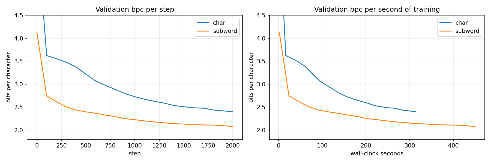

# Character vs Subword Tokenization Study

> How does the choice of tokenization impact model performance and behavior in NLP tasks?
>
> How does changing the input representation change what the model learns?

A small-scale, reproducible research project comparing **character-level** and **subword (BPE)** tokenization across vocabulary structure, sequence length, training dynamics, generation quality, and robustness. The full narrative lives in [`notebooks/experiment.ipynb`](notebooks/experiment.ipynb); the reusable engineering lives in [`src/`](src/). Both layers exist to serve the same study — the notebook walks through the experiments, `src/` is the library it calls.

---

## 1. Problem Statement

Modern language models are usually trained with subword tokenizers (BPE, WordPiece, SentencePiece), while older or specialized models sometimes use character-level inputs. Tokenization is often treated as a preprocessing detail, but it directly shapes:

- the vocabulary the model must learn,
- the length of the input sequences,
- the optimization landscape during training,
- and the model's ability to handle rare or unseen words.

This study isolates that choice by training the **same architecture** on the **same corpus** under two tokenization regimes and comparing the results.

## 2. Research Question

> *How does the choice of tokenization (character vs subword) affect how a language model learns, generalizes, and generates text?*

### Sub-questions

1. How does tokenization change vocabulary size and token frequency distribution?
2. How does it change average sequence length for the same text?
3. How does it affect training loss curves and convergence speed?
4. How does it affect generation quality (coherence, repetition, structure)?
5. How does it affect robustness to rare or unseen words (OOV)?

## 3. Methodology

| Axis              | Character-level                 | Subword (BPE)                    |
| ----------------- | ------------------------------- | -------------------------------- |
| Unit              | individual characters           | merged byte-pair units           |
| Vocabulary size   | very small (97 here)            | configurable (8k here)           |
| Sequence length   | long                            | short                            |
| OOV               | none                            | none (byte-fallback)             |
| Used in           | early RNN LMs, ByT5             | GPT, BERT, LLaMA, etc.           |

Both tokenizers feed into the **same** small Transformer decoder language model ([`src/model.py`](src/model.py)) trained with identical optimizer settings, so any differences in behavior are attributable to tokenization.

## 4. Experiments

1. **Vocabulary analysis** — size, coverage, token frequency distribution.
2. **Sequence length comparison** — tokens per document, distribution.
3. **Training behavior** — loss vs. step, wall-clock convergence.
4. **Model performance** — held-out cross-entropy and perplexity.
5. **Generation quality** — qualitative samples from each model.
6. **Robustness** — behavior on rare words, typos, unseen words.

## 5. Dataset

The study trains on **[Shakespeare plays for NLP: 91K Tagged Lines](https://www.kaggle.com/datasets/ismailalshofi/shakespeare-for-nlp-91k-tagged-lines)**, a structured CSV I prepared and published on Kaggle as part of this project.

- **Live dataset:** <https://www.kaggle.com/datasets/ismailalshofi/shakespeare-for-nlp-91k-tagged-lines>
- **What's in it:** 91,509 spoken lines across all 37 plays, with `play / play_title / act / scene / player / line_number / line_text` columns. 956 unique speakers, ~9 MB UTF-8.
- **How I prepared it:** sourced the Folger Shakespeare Library's TEI XML edition via the [dracor-org/shakedracor](https://github.com/dracor-org/shakedracor) mirror, parsed each play (`<div type="act">` → `<div type="scene">` → `<sp>` → `<l>`/`<p>`), dropped stage directions, normalised whitespace, and emitted one row per spoken line. Smart punctuation from the Folger edition is preserved.
- **License:** the underlying Folger text is CC BY-NC 3.0 (non-commercial, with attribution).

The prepared CSV ships with this repo at [`data/shakespeare_lines.csv`](data/shakespeare_lines.csv) and is loaded by [`src/utils.py`](src/utils.py)'s `load_corpus()`. **The project consumes this CSV directly — no runtime fetching, no rebuild step.**

## 6. Project Structure

```
tokenization-study/
├── README.md
├── requirements.txt
├── src/
│   ├── char_tokenizer.py         # character-level tokenizer
│   ├── subword_tokenizer.py      # BPE tokenizer (HuggingFace `tokenizers`)
│   ├── model.py                  # small Transformer decoder LM (MiniGPT)
│   ├── train.py                  # training entry point
│   └── utils.py                  # CSV loader, batching, metrics
├── notebooks/
│   ├── experiment.ipynb          # the full research narrative
│   ├── eda_shakespeare.ipynb     # standalone Kaggle EDA notebook
│   └── kaggle_run.ipynb          # runs both trainings on a Kaggle GPU
├── data/                         # mirror of the published Kaggle dataset
│   ├── shakespeare_lines.csv     # the corpus (single source of truth)
│   ├── dataset-metadata.json     # Kaggle dataset config
│   └── README.md                 # the dataset's Kaggle page
├── scripts/                      # one-off notebook generators
└── results/                      # plots, metrics, samples (checkpoints are not committed)
```

## 7. How to Run

Requires Python 3.10+.

```bash
# 1. install
pip install -r requirements.txt

# 2. train both tokenization regimes
#    (--data defaults to data/shakespeare_lines.csv)
python -m src.train --tokenizer char    --out results/char
python -m src.train --tokenizer subword --out results/subword

# 3. walk through the full study end-to-end
jupyter notebook notebooks/experiment.ipynb
```

Each run writes `history.json` (loss and bpc per eval step), `summary.json` (final metrics, parameter count, chars per token, train time), `sample.txt` and a checkpoint to `--out`.

No GPU? [`notebooks/kaggle_run.ipynb`](notebooks/kaggle_run.ipynb) runs both trainings on a free Kaggle GPU and zips the results for download.

## 8. Comparing the two runs fairly

**Per-token loss is not comparable across tokenizers.** A BPE token covers ~3 characters, so predicting one is a harder task than predicting one character, and its loss is naturally higher. The study reports **bits per character (bpc)**:

```
bpc = loss_nats_per_token / ln(2) / chars_per_token
```

The full runs show why this matters. The char model's val loss is **1.66** and the subword model's is **4.53**, which looks like a clear win for characters. In bpc it reverses: **2.40** for char vs **2.08** for subword.

### Known confounds

- **Parameter count.** The embedding and output layers scale with vocabulary size, so the subword model (8k vocab) has 7.3M parameters against 3.3M for the char model (97 symbols). The Transformer blocks in the middle are identical.
- **Context in characters.** Both models use `block_size=256` *tokens*, which is 256 characters for char and ~800 for subword. The subword model sees about 3x more text per step.

These are part of the comparison, not bugs, so the results are reported next to them instead of hiding them.

## 9. Results

Both models trained for 2000 steps on a Kaggle T4 GPU with the same settings (4 layers, 4 heads, 256-dim embeddings, context 256, batch 64, AdamW 3e-4).

| | char | subword (BPE 8k) |
|---|---|---|
| Parameters | 3.3M | 7.3M |
| Characters per token (val) | 1.00 | 3.15 |
| Val loss (nats / token) | 1.66 | 4.53 |
| **Val bits per character** | 2.40 | **2.08** |
| Training time | 313 s | 450 s |



### Key insights

- **Subword wins, but raw loss says the opposite.** 2.08 vs 2.40 bpc, about 13% fewer bits per character. The per-token loss (4.53 vs 1.66) would have pointed the wrong way.
- **Most of the win is extra text per step.** At the same training time subword still wins (2.14 vs 2.40). At the same amount of text seen, the gap almost closes (**2.35 vs 2.40**). With the same 256-token context, each subword step simply reads ~3x more Shakespeare.
- **Subword is bigger, slower and overfits first.** 2.2x the parameters, all in the embedding and output layers. Each step is ~44% slower, and its train/val gap is 0.19 bpc against 0.07 for char.
- **The char model hasn't converged.** It was still improving twice as fast as subword at the end of training, so a longer run would likely narrow the gap.
- **They make different mistakes.** Char invents words (*dwarwick*, *deservity*) but gets the shape of the page right. Subword only uses real words and real character names (Brutus, Iago, Desdemona) but loses the thread after a line or two.

| char | subword |
|---|---|
| `TONIOLANUS:`<br>`For you action, must deservity, liked.` | `IAGO:`<br>`You shall not go.` |
| `KING:`<br>`Of Where you as a false helphed my knave` | `LEONTES:`<br>`My father did it.` |

**Bottom line:** tokenization is not preprocessing. It decides how big the model is, how much text each step sees, what kind of mistakes it makes, and what a fair comparison even is. The full walk-through is in [`notebooks/experiment.ipynb`](notebooks/experiment.ipynb).

**Next steps:** match the context in characters instead of tokens, tie the embedding and output weights so the parameter counts are closer, and train longer to see where the char curve flattens.

## 10. License

Code: [MIT](LICENSE). Data: the Folger Shakespeare text is CC BY-NC 3.0, so the dataset is for non-commercial use with attribution.

## 11. Author

**Ismail Alshofi**: [GitHub](https://github.com/ismailalshofi) · [Kaggle](https://www.kaggle.com/ismailalshofi) · [Medium](https://medium.com/@ialshofi)
